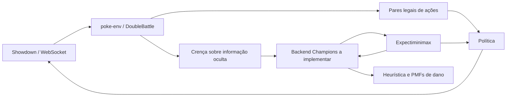

# Bot VGC: base executável e arquitetura probabilística

Python 3.12+, **poke-env 0.16.1**, decisões em duplas. Código e explicações em português.
Este projeto foi acrescentado em `vgc-bot/` ao repositório existente.

## 1. Regulação: M-C é Champions

O Showdown consultado em 11/10/2026 define **[Gen 9 Champions] VGC 2026 Reg M-C**,
ID `gen9championsvgc2026regmc`, mod `champions`, duplas, Flat Rules e Open Team Sheets.
A versão Bo3 usa `gen9championsvgc2026regmcbo3`.

**Esse mod desabilita Terastallization e permite Mega Evolução.** Portanto, incluir
Tera como ação de M-C seria incorreto. `battle.valid_orders` oferece a transformação
que o servidor autorizar. A arquitetura também admite Tera para outro formato VGC
que a permita, selecionado explicitamente por `--format`.

Fontes primárias, fixadas no commit Showdown `942cda71d14bf0618bd57991708a2e2734b6daba`:

- [Formatos: M-C, mod e regras](https://github.com/smogon/pokemon-showdown/blob/942cda71d14bf0618bd57991708a2e2734b6daba/config/formats.ts#L288).
- [Champions: canTerastallize retorna null; Mega e cálculo de stats](https://github.com/smogon/pokemon-showdown/blob/942cda71d14bf0618bd57991708a2e2734b6daba/data/mods/champions/scripts.ts).
- [Flat Rules e seleção de time](https://github.com/smogon/pokemon-showdown/blob/942cda71d14bf0618bd57991708a2e2734b6daba/data/mods/champions/rulesets.ts).
- [poke-env 0.16.1](https://pypi.org/project/poke-env/0.16.1/).

Champions altera a distribuição de pontos de stats: não importar automaticamente
spreads EV 252/252 de Scarlet/Violet. Em Champions, no nível padrão, o servidor usa
HP = base + pontos + 75; outros stats começam em base + pontos + 20 e recebem nature.
Valide time, learnsets, habilidades, itens e regras no servidor da revisão escolhida.
Os dados genéricos Gen 9 do poke-env não são um simulador de Champions.

### Referência fornecida: MetaVGC

[Regras M-C no MetaVGC](https://metavgc.com/pt/regulamentos/regulationm-c#rules),
fornecidas pelo usuário e consultadas em 11/10/2026, confirmam o escopo Champions.

| Regra descrita na página | Aplicação ao projeto |
| --- | --- |
| Duplas 4v4, registrar seis e selecionar quatro | `DoubleBattle`; snapshots dos quatro selecionados |
| Ajuste de todos os Pokémon ao nível 50 | Validação e resolução pelo servidor |
| Species Clause por número da Pokédex, incluindo variantes regionais | Validador do formato Showdown |
| Item Clause: nenhum item segurado repetido no time | Validador do formato Showdown |
| Mega Evoluções permitidas | Ordens legais autorizadas pelo request; benefício estratégico ainda exige simulador |
| 7 min por jogador, 45 s por turno, 90 s de preview, 20 min de partida | Referência de torneio informada pela página; conferir separadamente o timer do servidor |

A página informa vigência de 09/09 a 02/12/2026, 260 entradas de Pokémon e 166 itens,
com seis novas Mega Evoluções. Esses números são da fonte fornecida; não constituem
uma auditoria de equivalência de todo o elenco ao banco do Showdown/poke-env.
Não usamos essas contagens como critérios de legalidade: o time é validado no
formato e revisão do servidor escolhido.

**Diferenças que afetam a modelagem:**

- O `VGC Timer` da revisão Showdown testada define `Timer Max Per Turn = 55`,
  `Timer Starting = 420` e `Timer Max First Turn = 90`. Portanto, o smoke local
  não comprova a reprodução integral dos tempos de torneio indicados na página.
  A busca deve respeitar o tempo efetivamente restante, com margem para transporte,
  e um limite próprio inferior ao limite da competição; não gastar 45 s a cada turno
  quando o banco total é de sete minutos.
- O texto sobre Mega Baxcalibur chama Thermal Exchange de “imunidade a fogo”.
  Na revisão Showdown consultada, a habilidade **não elimina dano de Fogo**:
  bloqueia queimadura e aumenta Attack em um estágio após receber golpe de Fogo.
  Tratar esse dano como zero invalidaria rolls, sobrevivência e valor esperado.

Referências de execução: [VGC Timer no Showdown](https://github.com/smogon/pokemon-showdown/blob/942cda71d14bf0618bd57991708a2e2734b6daba/data/rulesets.ts#L778)
e [Thermal Exchange](https://github.com/smogon/pokemon-showdown/blob/942cda71d14bf0618bd57991708a2e2734b6daba/data/abilities.ts#L4992).
A configuração permanece `gen9championsvgc2026regmc`: as regras centrais da referência
confirmam essa escolha. As observações acima não acrescentam um simulador à base.

## 2. O que está implementado

| Componente | Entrega e limite |
| --- | --- |
| `bot.py` | `VGCBot(Player)`, `choose_move(DoubleBattle)`, pares legais, alvos e substituições |
| `vgc/connection.py` | CLI, conexão assíncrona pelo poke-env, contas local/pública, encerramento do socket |
| `vgc/policy.py` | Baseline funcional de pressão, STAB/tipos/precisão base, custo de dano aliado, Protect, Tailwind, Trick Room e trocas |
| `vgc/search.py` | Expectiminimax genérico executável, garantia pura maximin, poda segura de chance, cache e aprofundamento iterativo |
| `vgc/bridge.py` | `SearchPolicy`: injeta o backend e mapeia ações pesquisadas para ordens legais |
| `vgc/state.py`, `evaluation.py` | Snapshots imutáveis e avaliação limitada do tabuleiro simulado |
| `vgc/damage.py` | Interface de calculadora; PMFs de dano, precisão/crítico, EV, P(KO) e convolução |
| `vgc/belief.py` | Atualização Bayesiana estável sobre hipóteses conjuntas |
| `tests/` | Matemática, poda contra enumeração exaustiva e API real de duplas |

**A conexão usa `PressurePolicy` por padrão.** Ela não chama a busca nem a calculadora:
o adaptador de simulação fiel a Champions ainda precisa ser implementado. O motor
de busca é testável com modelos pequenos e a ponte para conectá-lo ao Player está
pronta. A heurística de pressão não estima dano real, probabilidade de vitória nem
utilidade ótima. A seleção 4-de-6 e os leads ainda usam o team preview aleatório do
poke-env. Mega/Tera legais são enumeradas, mas o baseline não estima seu benefício
nem as favorece quando o score empata.

Não há promessa de “100% otimizado” ou vitória sobre jogadores experientes: isso
exige fidelidade de mecânicas, dados, treinamento/calibração e avaliação competitiva.
O entregável é uma base inicial com fronteiras explícitas para esse trabalho.

## 3. Organização

```text
vgc-bot/
├── bot.py
├── pyproject.toml
├── requirements.lock.txt
├── README.md
├── vgc/
│   ├── __init__.py
│   ├── connection.py       # I/O e configuração
│   ├── policy.py           # Baseline executável
│   ├── bridge.py           # Observação → backend → ordem
│   ├── state.py            # Domínio imutável
│   ├── evaluation.py       # V(s)
│   ├── search.py           # Pares MAX/MIN e nós de chance
│   ├── damage.py           # Contrato e álgebra probabilística
│   └── belief.py           # P(estado oculto | histórico)
├── examples/               # Time e smoke test locais
└── tests/
    ├── test_bot.py
    └── test_core.py
```



## 4. Instalação e execução

```bash
cd vgc-bot
python3.12 -m venv .venv
source .venv/bin/activate
python -m pip install -r requirements.lock.txt
python -m pip install --no-deps --no-build-isolation -e .
python -m pytest -q
ruff check .
python bot.py --help
```

O lock registra o ambiente Python 3.12 de desenvolvimento, incluindo ferramentas de
teste. `pyproject.toml` descreve as dependências mínimas; para resolver um ambiente
novo sem esse lock, use `python -m pip install -e '.[dev]'`.

Para iniciar seu servidor local, siga o [guia oficial](https://github.com/smogon/pokemon-showdown/blob/master/server/README.md)
com Node compatível com a revisão escolhida. Na revisão acima, `node >=22.18.0`.
A porta padrão é 8000. Em servidor exclusivamente local de testes, a configuração
`exports.noguestsecurity = true` permite contas sintéticas sem autenticação externa.

```bash
python bot.py --team examples/team.txt --server local \
  --username VGCExample --opponent SeuUsuarioLocal --battles 1
```

Abra um cliente conectado ao servidor e desafie `VGCExample` em M-C. O bot aceita
somente o usuário informado. O time de exemplo é um fixture de integração, não uma
recomendação de time competitivo. Para o servidor público, use `--server showdown`,
seu time válido e `--username`; uma conta registrada lê a senha de `SHOWDOWN_PASSWORD`.
Não coloque senha no código, no time ou em argumentos de linha de comando.

## 5. Teoria dos jogos: quatro ações simultâneas

Para cada lado, uma ação é um **par**:

```text
a = (ordem_slot_1, ordem_slot_2)
b = (ordem_rival_1, ordem_rival_2)
```

Uma ordem pode ser golpe com alvo e transformação, troca ou pass em uma fase
obrigatória. O produto cartesiano é filtrado por legalidade: duas trocas não podem
usar o mesmo reserva; não se pode gastar duas vezes a transformação do time.
Os alvos Showdown são `+1/+2` para rivais e `-1/-2` para aliados; alguns golpes
spread não têm alvo explícito. O poke-env realiza essa enumeração.

O modelo define o pagamento:

\[
Q_d(I,a,b)=\sum_o P(o\mid I,a,b)V_{d-1}(\tau(I,a,b,o)).
\]

`I` é o estado de informação (crença e histórico público), `o` uma observação futura,
e `τ` a atualização da crença depois de resolver o turno. O backend deve integrar
hipóteses ocultas e aleatoriedade. A busca fornecida calcula:

\[
V_d(I)=\max_a\min_b Q_d(I,a,b), \quad V_0(I)=h(I).
\]

Isso é a **garantia de estratégia pura**, uma preferência conservadora. Enumerar
colunas depois das linhas é cálculo de uma matriz simultânea; não representa um
rival que observa o comando antes de escolher. Esse valor pode subestimar a garantia
com mistura de ações. Matching pennies tem garantia pura -1 e equilíbrio misto 0.
Para jogo adversarial mais forte, resolva por programação linear:

\[
\max_{x,v}v,\qquad Q^T x\ge v\mathbf{1},\quad x\ge0,\quad \sum_a x_a=1.
\]

Amostre uma ação conforme `x`; aleatoriedade estratégica evita exploração. Para
explorar padrões de um adversário, substitua o mínimo por uma política estimada:
`sum_b π(b|I) Q(I,a,b)`. Uma alternativa robusta mistura essa expectativa com o pior
caso, com peso calibrado em partidas separadas. Não use frequência global fixa de
Protect como previsão contextual.

### Poda alpha-beta adaptada

`alpha` é o melhor valor garantido já encontrado; `beta` é o menor pagamento da
linha atual. Se `beta <= alpha`, a linha não melhora a decisão.

No nó de chance, seja `z` a soma ponderada já avaliada e `p` sua massa. Como todos
os filhos pertencem a `[-1,1]`, a expectativa total está em:

\[
[z-(1-p),\ z+(1-p)].
\]

Se o **limite superior** for `<= alpha`, há uma resposta rival suficiente para
eliminar a linha. O código descarta a linha sem retornar a soma parcial como valor
exato. Cada filho probabilístico é pesquisado sem uma janela herdada incorretamente.
Essa disciplina impede a poda inválida de uma jogada que começa por um roll ruim,
mas tem ótimo EV total. O cache contém somente valores exatos de buscas concluídas.

Complexidade sem poda: aproximadamente `O((A * B * C)^d)`, onde A/B são números de
**pares** legais e C de sucessores probabilísticos. Para performance: ordenar bons
pares primeiro, agregar estados equivalentes, memoizar dano, usar tabelas de
transposição por crença e aprofundamento iterativo. Truncar para top-k muda a
solução; deve ser um modo aproximado explicitamente mensurado.

O deadline é cooperativo entre expansões. O backend deve também limitar o custo de
`actions/outcomes`; uma única chamada bloqueante não pode ser interrompida pelo motor.
Não compartilhe uma instância de busca simultaneamente entre batalhas.

## 6. Heurística do tabuleiro

A implementação está em `vgc/evaluation.py`:

\[
h(s)=\tanh(1.6\Delta HP+1.2\Delta N+0.5\Delta T+
0.5\Delta S+0.3\Delta F+0.1\Delta R).
\]

- `ΔHP`: soma das frações de HP dos quatro selecionados, diferença dividida por 4.
- `ΔN`: diferença de sobreviventes dividida por 4; perder uma peça tem custo além do HP.
- `ΔT`: cobertura STAB por tipos entre ativos, normalizada por 4 e pelo número de pares.
- `ΔS`: saldo de comparações de velocidade; Tailwind dobra Speed, Trick Room inverte
  a preferência. Empates valem zero. Stats já devem incluir boosts/paralisia; o
  backend resolve prioridade, que esta feature simplificada não representa.
- `ΔF`: benefício relativo de sol/chuva e terreno ofensivo para ativos compatíveis,
  incluindo grounded. Não basta contar “tenho clima”: clima é compartilhado.
- `ΔR`: diferença de recurso de transformação ainda disponível.

Vitória/derrota/empate retornam `+1/-1/0`, antes da heurística. Pesos são iniciais:
calibre-os e considere PP, status, boosts, dano residual, imunidades e turnos restantes.
Esta avaliação não é uma estimativa calibrada de P(vitória). Aplicar `tanh` à média
entre hipóteses não é igual a calcular a média de `tanh`: avalie cada hipótese e
integre com seu peso. Nunca conte os seis Pokémon do preview como seis selecionados.

## 7. Rolls, precisão, chance de KO e risco

Para um golpe comum, os 16 multiplicadores aleatórios são os inteiros 85..100.
A calculadora deve retornar os **danos inteiros finais** correspondentes, respeitando
arredondamentos na ordem do simulador. Não use uma única fórmula contínua. Críticos,
Focus Sash, habilidade, item, STAB, spread e modificadores não são detalhes opcionais.
Para Champions, valide qualquer calculadora externa contra o mod: suporte genérico
a Gen 9 não demonstra compatibilidade. `DamageCalculator` expõe esse contrato.

Com precisão efetiva `a` e probabilidade de crítico `c`:

\[
P(D=d)=(1-a)\mathbf1_{d=0}+a[(1-c)P(D=d|normal)+cP(D=d|crit)].
\]

\[
E[D]=\sum_d dP(D=d),\qquad P(KO)=\sum_{d\ge HP_{alvo}}P(D=d).
\]

Exemplo executável, com rolls **ilustrativos já calculados**:

```python
from vgc.damage import distribution

hit = distribution(tuple(range(85, 101)), accuracy=0.8)
assert hit.mean == 74.0
assert hit.ko_probability(90) == 0.55  # 0.8 * 11/16
```

O maior dano esperado não implica a melhor decisão: se um golpe fraco garante KO,
um golpe forte e impreciso pode perder sem trazer benefício adicional ao acertar.
Use `E[V(s')]`, contabilizando sobrevivência, tempo e continuidade, em vez de maximizar
somente dano. Dois golpes no mesmo alvo exigem ordem, possíveis KOs antes de agir,
Protect e redirecionamento; a convolução implementada só é válida sob independência
condicional e quando ambas as ações realmente ocorrem.

Protect é escolha estratégica; sua falha consecutiva é evento probabilístico
condicionado ao histórico. Tailwind/Trick Room alteram a ordem de ação no simulador;
velocidade em Gen 9 é dinâmica durante o turno. Speed ties, prioridades, Fake Out,
Follow Me, Wide Guard e Helping Hand precisam de transições próprias. Nem os quatro
rolls de dano nem os quatro acertos devem ser assumidos independentes indiscriminadamente.

Para aversão a risco, use utilidade côncava limitada sobre resultado/material ou
`J = E[V] - λ CVaRα(-V)`; CVaR mede a cauda de perdas. Esse objetivo exige rederivar
limites e decidir consistência temporal: não acrescente variância/CVaR ao algoritmo
atual e mantenha as mesmas podas sem prova. O motor atual maximiza EV sob resposta
adversária de pior caso; ele não implementa CVaR. Com estados terminais apenas, EV em
`{-1,0,+1}` corresponde a `P(vitória)-P(derrota)`.

## 8. Informação imperfeita e inferência

Mantenha hipóteses **conjuntas** de seleção 4-de-6, pontos/natures e itens/habilidades
quando não revelados, com prior de metagame/versionamento por regulação. OTS reduz o
espaço de sets, mas não revela ações futuras. Não extrapole independência entre
membros do mesmo time. Dano observado, OTS, moves revelados e ordem dos ataques
atualizam:

\[
P(h|o)={P(o|h)P(h)\over\sum_{h'}P(o|h')P(h')}.
\]

`Belief.update()` calcula isso em log-space. Observação incompatível com todas as
hipóteses produz erro explícito: ampliar suporte/rever modelo é necessário. Não
“corrija” silenciosamente com uma distribuição uniforme. HP do rival frequentemente
é mostrado arredondado: a likelihood soma probabilidades de rolls compatíveis com
um **intervalo**, considerando o protocolo de exibição.

Evite *strategy fusion*: escolher um plano diferente para cada set oculto em cada
ramo dá informação impossível ao agente. A ação deve ser compartilhada entre estados
indistinguíveis e a crença deve ser atualizada apenas com observações acessíveis.
O parâmetro `S` do motor permite representar esse estado de informação.

## 9. Conectar a busca e evoluir até um agente competitivo

```python
from bot import VGCBot
from vgc.bridge import SearchPolicy

# A IMPLEMENTAR: constrói crença imutável e um BattleModel Champions.
# O modelo usa mensagens de ordens como IDs na raiz; mantém todas as ações legais.
# model, belief_state = build_champions_model(battle, legal_order_messages)
# bot = VGCBot(policy=SearchPolicy(build_champions_model), ...)
```

O backend deve usar uma revisão fixada do simulador Showdown e resolver os turnos
sobre cópias isoladas de hipóteses. Um processo Node persistente com IPC e snapshots
é uma opção; `simulate-battle` sozinho executa batalhas, não fornece automaticamente
clonagem de estado, controle de RNG ou crenças. Preserve ordem exata de eventos,
serialização, geração de ações e distribuição de RNG. Não use estado privado do
servidor da batalha real como informação do agente.

Próximas etapas, na ordem:

1. **Backend fiel + testes diferenciais:** replay de transições, dano, spread,
   Mega, prioridade, speed ties, Protect consecutivo, trocas e fim de turno.
2. **Preview e modelo de adversário:** seleção 4-de-6 e leads, OTS, posterior de sets,
   comportamento condicionado ao estado e histórico entre jogos de Bo3.
3. **Matriz simultânea e busca:** estratégias mistas, ordenação, orçamento de decisão,
   execução em processos fora do loop WebSocket, deadline também no backend.
4. **Aprendizado:** política e valor treinados por self-play com observações mascaradas,
   ações legais e recompensa terminal. Para shaping, usar `γΦ(s')-Φ(s)` quando as
   hipóteses de invariância se aplicarem; não otimizar dano infligido como objetivo final.
5. **Avaliação:** seeds e times separados por treino/validação, baselines, ablações,
   taxa de vitória com intervalo de confiança, calibração de P(KO), latência p95/p99,
   taxa de ordens inválidas e desempenho por matchup. Uma partida smoke não mede força.

## 10. Verificação desta entrega

Ambiente observado: Python 3.12.15, poke-env 0.16.1, Node 24.14.1 e Showdown na
revisão fixada acima. Os testes unitários/de integração de API passaram, assim como
lint, formatação, instalação editável e `pip check`. O validador oficial aceitou
`examples/team.txt` em M-C. Uma partida local via WebSocket entre `VGCBot` e
`RandomPlayer` terminou normalmente em quatro turnos. Esse smoke verifica a
integração básica; não valida todas as mecânicas de Champions nem força competitiva.

Para repetir, com o pacote instalado e servidor local preparado:

```bash
python examples/local_smoke.py
```

A escolha aleatória de preview/oponente torna o número de turnos variável. Não há
backend de simulação Champions, treinamento RL, avaliação em ladder ou solver de
estratégias mistas incluídos nesta versão.
